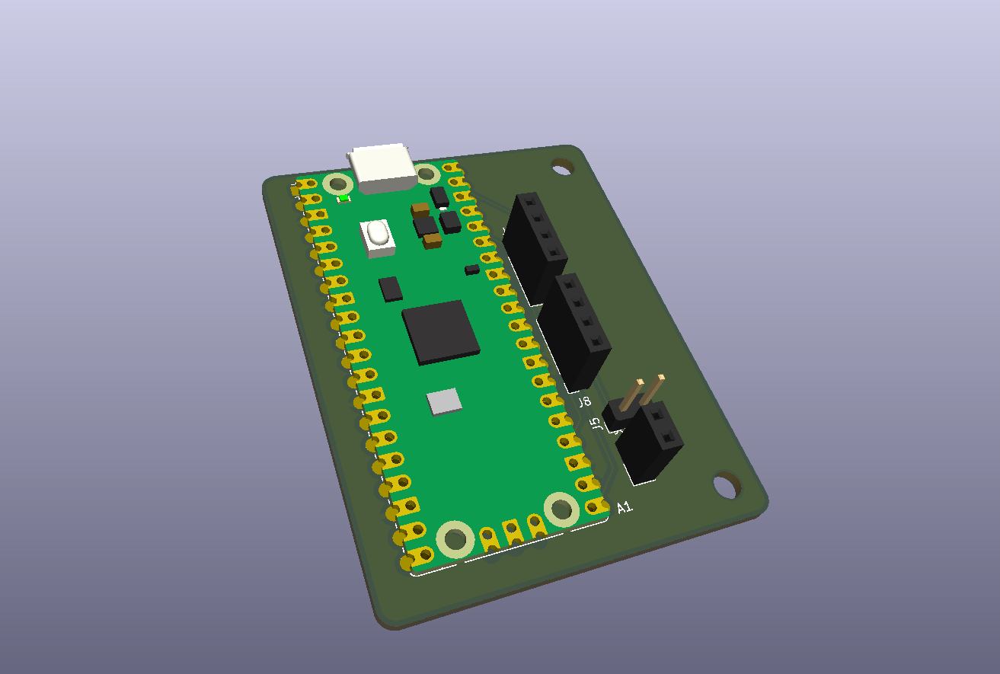
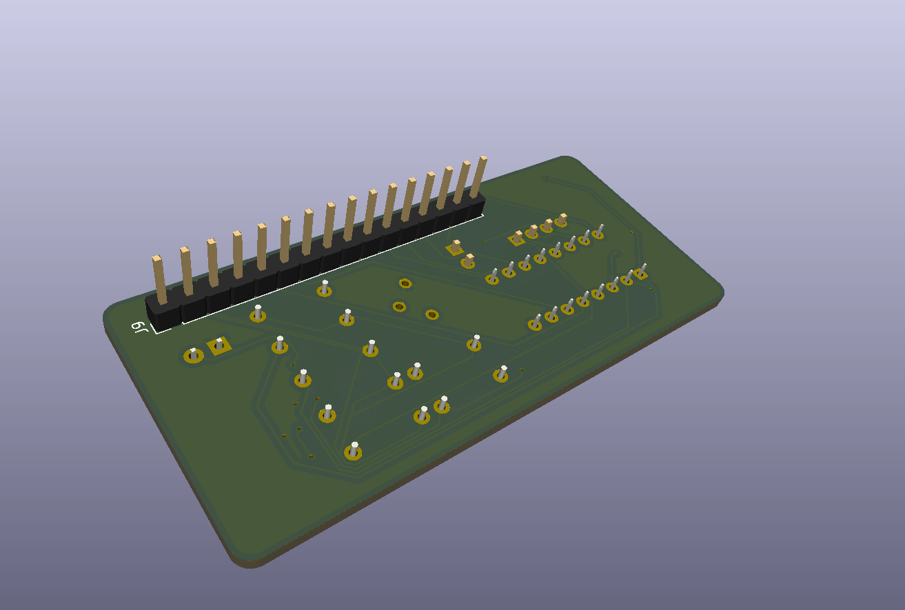
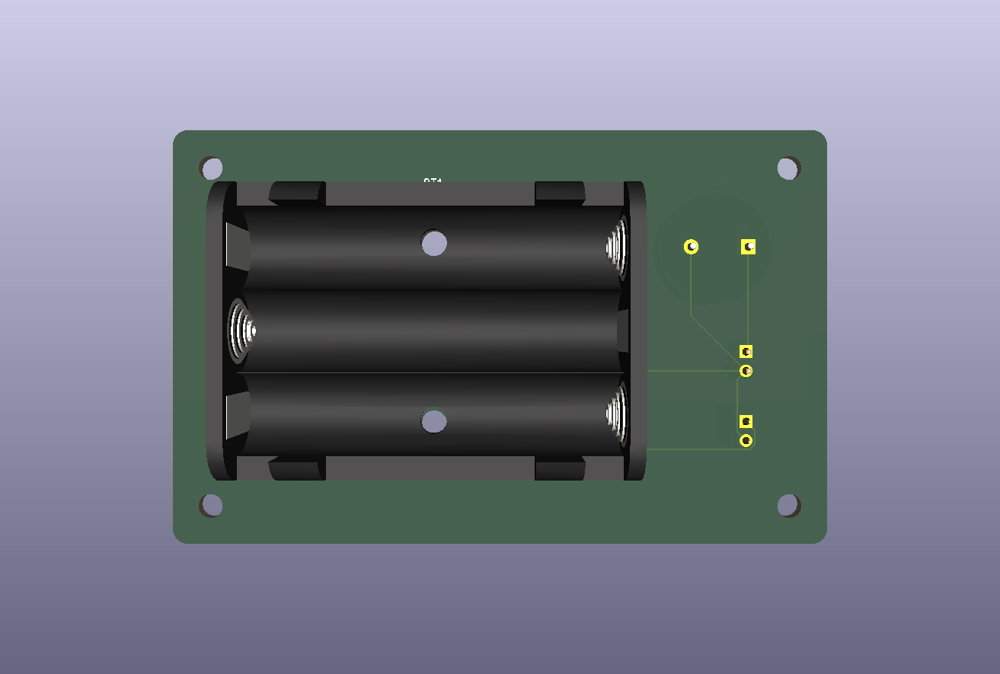
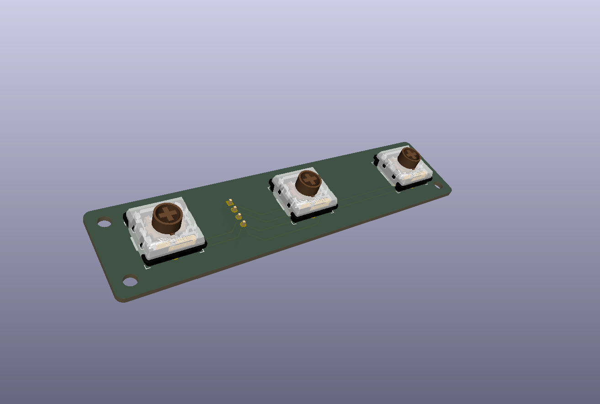

<h1>Portable Timer!</h1>
 <h2><em>A timer that you can take with you!</em></h2>

 This is Portable Timer! It's a small timer that you can take with you <em>anywhere!</em> Take it with you to the beach, the car, or even to outer space! The possibilities are limitless! Now, you may be wondering, <em>Why don't you just use a timer on your phone?</em> My answer to that is <em><strong>Where's the fun in that???</strong></em>

  This project is made up of 4 boards:
The Main Board, found <a href="https://github.com/bojorno1/Portable-Timer/tree/main/boards/Main_Board"> here... </a>

 The Button Board, found <a href="https://github.com/bojorno1/Portable-Timer/tree/main/boards/Button_board">here...</a>

 The I2C Backpack (thanks to <a href="http://electronicsgate.com/Images/lcd_backpack/schematic.png">electronics gate</a> for making a great base on how to make one of these!) found <a href="https://github.com/bojorno1/Portable-Timer/tree/main/boards/I2CBackpack">here...</a>

 and finally...

 The Battery Board, found <a href="https://github.com/bojorno1/Portable-Timer/tree/main/boards/Battery_Board">here...</a>

 These 4 boards all connect together with jumper wires, as shown in the PCB Schematic, found <a href="https://github.com/bojorno1/Portable-Timer/blob/main/boards/schematic.pdf">here...</a>